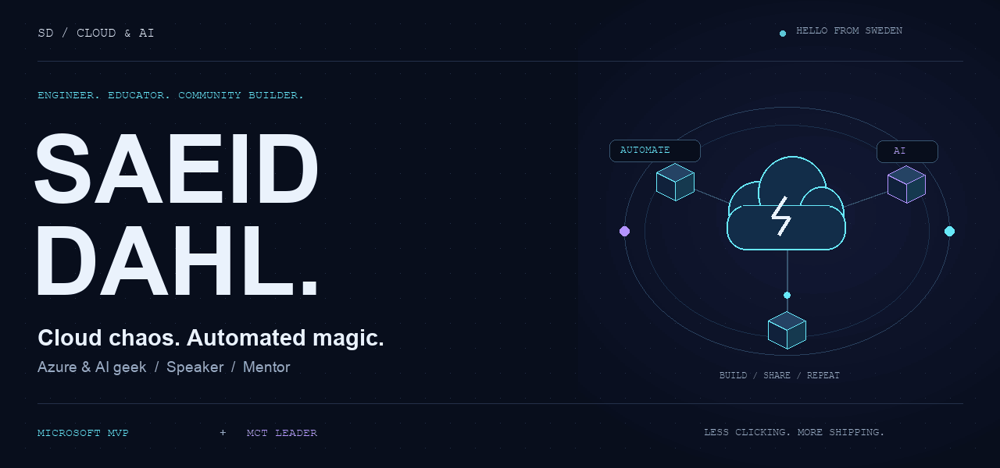
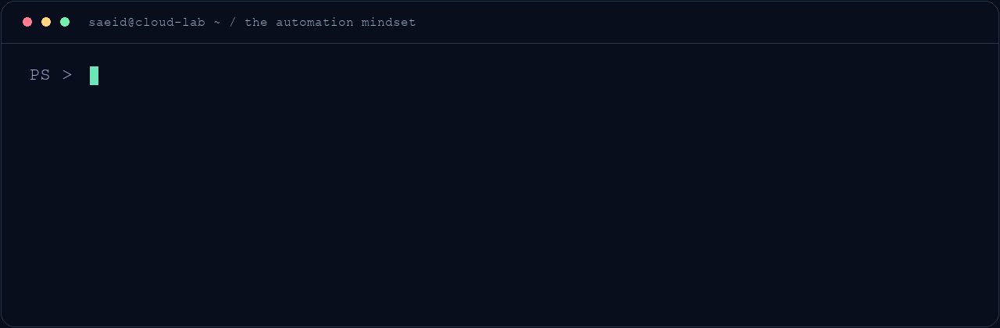
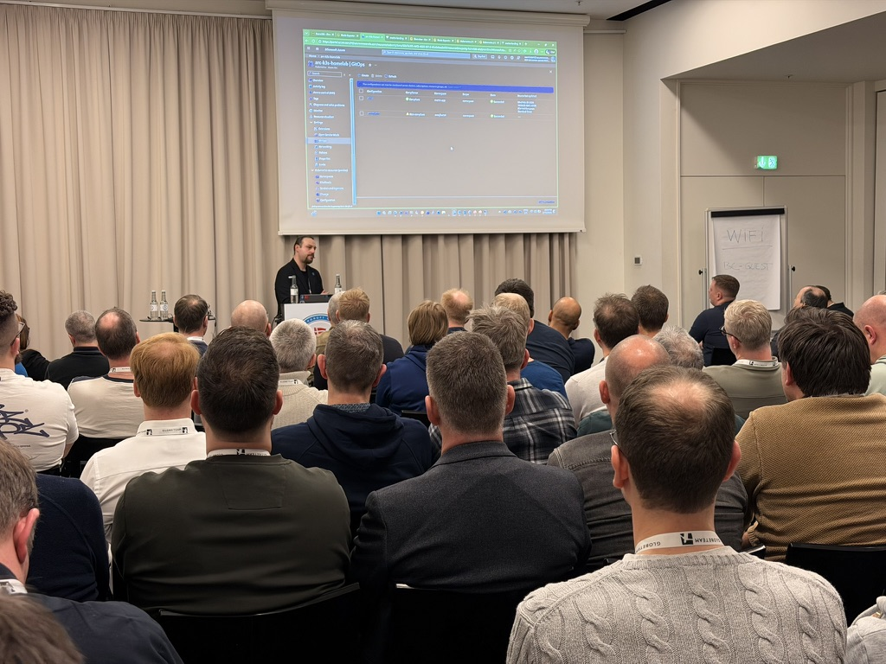
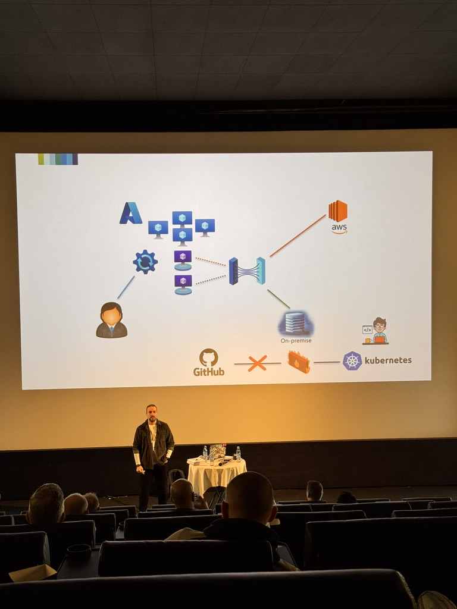

<!-- Profile README for github.com/saeid-adz. Artwork: scripts/generate_profile_assets.py -->

### I build cloud foundations. Automate the chaos. Bring people along.

**Head of Public Cloud & AI at [Upheads](https://upheads.se) · Microsoft MVP · MCT Leader · Sweden 🇸🇪**

[About](#-the-human-behind-the-terminal) &nbsp; / &nbsp; [Cloud lab](#-inside-my-cloud-lab) &nbsp; / &nbsp; [On stage](#-from-the-terminal-to-the-stage) &nbsp; / &nbsp; [Toolkit](#-the-toolkit) &nbsp; / &nbsp; [Connect](#-lets-build-something-worth-sharing)

---

## 👋 The human behind the terminal

Hey, I'm **Saeid** — an Azure & AI geek who enjoys turning complicated cloud problems into things people can actually use.

My world sits somewhere between **cloud architecture, automation, AI, and a room full of people asking great questions**. At Upheads, I lead Public Cloud & AI. In the community, I'm a speaker, trainer, mentor, and enthusiastic sharer of whatever I've just figured out.

I like solid foundations, useful experiments, and that moment when a manual process becomes a single command.

> **My operating principle:** Automate everything, then automate the automation. ✨

<table>
<tr>
<td width="50%" valign="top">

### ☁️ Builder mode

Secure, scalable cloud platforms. Landing zones that make sense. Infrastructure as Code. Guardrails that help teams move forward.

**Less clicking. More shipping.**

</td>
<td width="50%" valign="top">

### 🤝 Community mode

Talks, workshops, teaching, and mentoring. Sharing the practical lessons, the experiments, and the things I'd do differently next time.

**Learn it. Build it. Share it. Repeat.**

</td>
</tr>
</table>

## 🚀 Inside my cloud lab

A little animated illustration of how I approach the work. [Prefer still graphics?](assets/profile/automation-loop-still.png)

### The problems I like getting into

| Area | What I'm here to do |
| :--- | :--- |
| ☁️ **Azure architecture & landing zones** | Build foundations that can grow without becoming a maze. |
| ⚙️ **Automation & Infrastructure as Code** | Turn repeatable work into code with Bicep, Terraform, and PowerShell. |
| 🤖 **AI, agents & copilots** | Explore how AI can solve real problems beyond a compelling demo. |
| 🔐 **Security, identity & governance** | Make sensible guardrails part of the platform from the beginning. |
| 🔄 **DevOps & delivery** | Bring infrastructure and delivery workflows closer together. |
| 🎓 **Teaching & mentoring** | Make cloud and AI more approachable, one useful explanation at a time. |

**Curious about what I'm building?**

[Browse my repositories →](https://github.com/saeid-adz?tab=repositories) &nbsp; · &nbsp; [Visit saeiddahl.com →](https://saeiddahl.com)

---

## 🎤 From the terminal to the stage

I love the point where a technical idea becomes a conversation. You'll find me sharing practical cloud and AI lessons at community events, workshops, and on stage.

<table>
<tr>
<td width="57%" align="center" valign="top">

 
<b>Ideas are better when you share them.</b>
</td>
<td width="43%" align="center" valign="top">

 
<b>From architecture diagrams to real conversations.</b>
</td>
</tr>
</table>

### Put me in a room with curious people

**User group? Conference? Team workshop?** Let's talk Azure foundations, automation, cloud governance, or making AI useful in the real world.

## 🛠️ The toolkit

The tools change. The aim stays the same: **build something useful, make it repeatable, and help people understand it.**

**Cloud, identity & AI**

**Code, automate, repeat**

**Build & ship**

---

## 🏅 Credentials, with a community mindset

| Recognition | What I bring to it |
| :--- | :--- |
| **Microsoft Most Valuable Professional (MVP)** | Sharing knowledge and contributing to the community. |
| **Microsoft Certified Trainer (MCT) Leader** | Helping people build confidence with cloud and AI. |
| **Speaker & mentor** | Practical conversations, shared learning, and a reason to keep exploring. |

<b>🧭 Pick a conversation starter</b>

 

- **“Our Azure environment has grown a bit wild.”** Let's talk landing zones, identity, and governance.
- **“We keep doing this manually.”** Sounds like an automation opportunity.
- **“We want to do something useful with AI.”** Start with the problem, then explore the agents and copilots.
- **“Can you explain this to our team?”** That's what the whiteboard is for.
- **“Would you speak at our event?”** Tell me about your audience and what they'd love to learn.

<b>📊 Explore the GitHub side</b>

 

The code and activity live here on GitHub:

- [Repositories — projects, experiments, and things I'm working on](https://github.com/saeid-adz?tab=repositories)
- [Profile — contributions and recent public activity](https://github.com/saeid-adz)
- [Stars — things that caught my attention](https://github.com/saeid-adz?tab=stars)

## ✨ Let's build something worth sharing

Got an interesting cloud problem, an AI idea, or a community event in mind? **Let's connect.**

 

**BUILD SOMETHING. LEARN SOMETHING. SHARE SOMETHING.**

Made of cloud curiosity, automation, and community energy. 🇸🇪

[View the still banner](assets/profile/mission-control-still.png)

